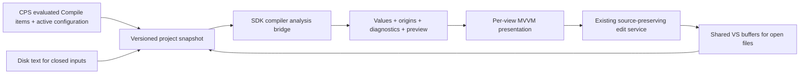

# Milestone three: reference-aware ALMX editing

Status: implementation and runnable validation through iteration sixteen are
complete: snapshot input, located
diagnostics, detached field/procedure provenance, an isolated SDK bridge, and
project analysis subscriptions with buffer/disk snapshots, and designer reference
selection/scalar inheritance with chain adorners, inherited procedures, and section
commands, live designer/Error List diagnostics, and resolved-alarm/compiled XML
previews, plus measured designer performance, preview accessibility fixes, and
repeatable linked-project acceptance with live-host selector accessibility and
local-override focus fixes, contextual action names, two-host functional acceptance,
and running-IDE analysis/lifecycle measurements. Release acceptance remains open
for spoken screen-reader output, native high contrast, mixed-DPI transitions,
keystroke-to-paint responsiveness, and remaining whole-IDE memory growth. The
extension binding-retention paths found by heap profiling are fixed; see iteration
fifteen for the measured scope and limits. Continue the MVVM,
constructor injection, and shared document-buffer architecture from
[milestone two](MILESTONE-2.md).

The outcome is a designer that explains where an alarm's effective values come
from, supports reference selection and navigation, and shows live compiler
diagnostics and a resolved preview across the current project's ALMX inputs.

## Starting point and scope

The milestone-two designer edits local XML values and ordered local procedure entries.
Iterations five and six add inherited scalar and procedure values. The compiler already resolves references
across files, scalar fallback, ordered procedure inheritance, and `Clear`.
Milestone three exposes those existing semantics without changing the ALMX format.

Include:

- Project-scoped reference completion in the designer and Go to reference/source.
- Effective Name, Code, Category, and Description with inheritance provenance.
- A WPF `Adorner` and chain icon on fields displaying a referenced value.
- Inherited/local procedure presentation for Instructions and Reset, with explicit
  section commands for replacing inheritance or making a local copy.
- Live ALM0001-ALM0004 diagnostics, source navigation, and a read-only resolved
  preview using current document-buffer contents.

Project-wide rename/refactoring, cross-project reference semantics, individual
inherited-step overrides, XML IntelliSense/squiggles, and changes to output format
are outside this milestone. The XML pane retains its existing language service.

The updated milestone-two validation record confirms project-item Save As/RDT
identity and final native-editor smoke checks on VS2022 and VS2026. The earlier
disposed-window failure was caused by the smoke using a renamed IDE command.
Dirty-close and external-change cancellation were also exercised on both hosts.
Preserve those regressions as project analysis is added. Checkout against a
checkout-based source-control provider and large-file performance remain unverified.

## Semantic contracts to preserve

The implementation and tests in `../Compiler/Syntax/AlarmSyntaxNode.cs`,
`../Compiler/Syntax/ReferenceableCollection.cs`,
`../Compiler.UnitTests/Syntax/AlarmTests.cs`, and
`../Compiler.UnitTests/Syntax/ReferenceableCollectionTests.cs` establish:

| Subject | Existing behavior and design consequence |
| --- | --- |
| Scalar fallback | Name, Code, Category, and Description inherit when the local string is null or empty. An explicit empty XML element still falls back. A nonempty local value wins, even when it equals the inherited text. |
| Identity | FullyQualifiedName and ReferenceName are local identifiers, not inherited fields. Reference lookup uses ordinal, case-sensitive names. |
| Procedure composition | Start with the referenced alarm's resolved section, then process local entries in source order. Instructions and Reset resolve independently. |
| Clear | Discard every preceding entry in that section, including preceding local entries. Clear is a source directive and is absent from the effective sequence. Multiple Clears are valid. |
| Step identity | Entries have kind and text, with no stable semantic step identifier or individual override/remove directive. Position and equal text cannot identify an inherited step for replacement. |

Keep source presence, raw local text, effective value, and origin separate.
`IsPresent` must continue to describe the XML. Do not equate a checked checkbox
with an effective local override, or infer inheritance by comparing strings.
Changing explicit-empty behavior would be a separate compiler-format decision.

## Project analysis and ownership

Add a small project analysis service alongside the existing document services.
The design follows Roslyn's separation of source, semantics, and host integration:
its [Workspace implementation](https://github.com/dotnet/roslyn/blob/main/src/Workspaces/Core/Portable/Workspace/Workspace.cs)
exposes a current immutable project/document snapshot. Adapt that pattern to an
ALMX project; do not introduce a Roslyn dependency or its complete workspace stack.



Suggested responsibilities, with names finalized during implementation:

| Component | Responsibility and lifetime |
| --- | --- |
| CPS project-input adapter | Subscribe to evaluated Compile membership, configuration, project/SDK changes, and unload. One subscription per project context. |
| Project analysis service | Own immutable input/result snapshots, scheduling, and cancellation per project context. Share results among designer windows. |
| Compiler analysis bridge | Analyze snapshot text with the project's resolved SDK compiler; return host-independent result data. Never own document persistence. |
| Document model/edit service | Retain local XML projection, version checks, drafts, and targeted edits through the existing buffer session. |
| Field/procedure view models | Combine local source and current semantic results without writing inherited values back. Remain per view. |
| WPF inheritance behavior | Attach/detach adorners and expose visual state; contain no binding or compiler rules. |

Keep CPS/VSSDK adapters in `ProjectSystem/` and `Editor/`, project analysis models
in `Analysis/`, and presentation in `UI/`. Use typed factories
and constructor injection through existing MEF composition. No service lookup
inside models/view models. Update AGENTS.md's project map when these folders are
actually introduced.

Input and scheduling rules:

- Use evaluated `Compile` items for the active project configuration, including
  explicit/conditional items and SDK exclusions. Do not independently glob files
  or index all files in the solution. Preserve input order and compiler name rules.
- An open file's current shared buffer wins over disk, including when only the
  XML editor is open. Uncommitted control drafts stay local until normal commit.
  Analysis must neither save documents nor invoke an output-writing Build target.
- Observe closed-file changes, membership changes, rename, Save As, buffer close,
  configuration switches, SDK changes, and project unload. A file linked into two
  projects shares its buffer but gets separate results for each project context.
- Capture immutable text and input versions; debounce edits (initially 250 ms),
  perform compiler work off the UI thread, and cancel superseded requests. Publish
  only when the project generation, configuration, and document versions still
  match. Never share the compiler's mutable syntax nodes between runs or views.
- Do not overwrite active drafts on a semantic refresh. After an upstream edit,
  refresh inherited presentation, but require a current result for commands that
  copy effective values. Validate all participating versions before such a write.
- For malformed or unreadable input, mark project analysis incomplete and clear
  obsolete live errors. Retain local editing in other valid documents. Do not
  present cached inheritance as current or flood Error List with missing-reference
  errors caused only by an input that could not be parsed.
- Loose files retain local editing and parsing. Project-wide semantics require an
  owning project with a compatible resolved SDK; show that state explicitly for
  loose/excluded files or unavailable SDKs. Do not borrow an arbitrary project's
  compiler or reference universe. Offer a context choice for shared project items.
- Dispose subscriptions and pending work on project unload, without disposing
  shared document sessions still owned by Visual Studio.

## Compiler boundary and source provenance

Keep the SDK's compiler authoritative. The VSIX currently has no compiler project
reference and must not acquire a private compiler copy for this feature. Start
with a feasibility slice that obtains the restored SDK location from project
evaluation and analyzes unsaved text with its `tasks/net472` compiler. Prove
version compatibility and isolation when two projects use different SDK versions;
record the loading/isolation mechanism before implementing the full UI. If the
SDK is unavailable or lacks the analysis contract, retain local editing and give
a precise restore/version message. Never silently substitute another compiler.

Extend the compiler with a host-independent analysis result for source identity,
field origin, surviving procedure-entry origin, and diagnostic locations. Reuse
its ALMX parser, Binder, and resolution rules; the extension's XML projection
remains responsible for safe text edits, not a second semantic implementation.
Adapt snapshot text through the parser without temporary saves. Preserve DTD
prohibition and unknown-element skipping.

Origins need document identity, snapshot version, alarm identity/source position,
field or procedure section/entry position, and source span. Report the actual
defining alarm through multi-hop references, with the intermediate reference chain
available for explanation. Do not key provenance only by FullyQualifiedName:
duplicates and unnamed alarms must remain distinguishable. Equal procedure text
does not imply equal origin. For UI explanations, also expose which Clear excluded
an entry; keep excluded entries out of the resolved output model.

Iteration one adds optional declaration locations without changing existing
diagnostic constructors, IDs, or messages. Locations are captured while parsing
and attached during binding. Duplicates identify both declarations; reference
errors identify ReferenceName elements, with related locations for cycle members.
MSBuild now logs file/line ranges from the same data. Iteration two adds resolved
value/procedure provenance; designer navigation remains to be implemented. All compiler APIs
remain compatible with `net472;net8.0` and independent of WPF/CPS.

This analysis contract requires a matching SDK release. Preserve both task
runtimes, package-content checks, existing Arcade imports, and SDK-first release
ordering. Extend the package rather than introducing a second compiler path.

## Design note: inherited scalar fields

Use a custom `InheritedValueAdorner : System.Windows.Documents.Adorner` to draw
a chain icon when a field is displaying a value supplied by a referenced alarm.
This is a required part of the design. Scope it to Name, Code, Category, and
Description; merely having a ReferenceName must not decorate local overrides.

| State | Presentation and editing |
| --- | --- |
| Effective local value | Show the local value normally, without a chain icon. |
| Effective inherited value | Show the effective value and chain icon, with origin text such as "Inherited from Base.Pump in Common.almx". |
| Explicit empty local element | Keep its presence checkbox checked and preserve the empty XML value; show the inherited effective value with the same icon and an explanation that the local element is empty. |
| No effective value | Show an empty field; do not imply that a referenced alarm supplies a value. |
| Invalid/unavailable analysis | Keep local source accessible and show diagnostic/pending state separately from inheritance. |

Keep a one-way effective display separate from the two-way local draft. Inherited
presentation is read-only and selectable. **Override locally** starts a local
draft seeded from the current effective value; normal commit writes only the
selected field. **Use inherited value** removes that local element. Both follow
the existing conflict checks and shared Undo/Redo. Keep the explicit presence
control for XML fidelity. Empty committed values still follow compiler fallback.
An untouched inherited display, focus change, preview refresh, or Save must never
materialize an override. Escape cancels the draft without changing XML.

Microsoft's [WPF adorner documentation](https://learn.microsoft.com/en-us/dotnet/desktop/wpf/controls/adorners)
describes the separate AdornerLayer, attaching via GetAdornerLayer/Add, and
pass-through hit testing. Use an `AdornerDecorator` in the designer to provide a
layer. An attached behavior manages creation/removal when controls load, unload,
change data context, or change inheritance state; supply state explicitly because
the layer owns the adorner. Set the decorative adorner's `IsHitTestVisible=false`.

Reserve space for the glyph so it cannot cover text, caret, scrollbars, or
validation indicators. Use a vector chain icon and VS theme brushes; check DPI,
high contrast, scrolling, and pane resizing. Put tooltip and accessible origin
text on the field, plus a keyboard-accessible **Go to source** command outside
the decorative overlay. Keep these commands available in read-only files where
navigation is still possible. The icon must not be the only indication of origin.

## Recommended TestProcedure interaction

Use the same chain visual language at **row level**, with independent controls
for **Instructions** and **Reset**. Each section shows inherited entries followed
by local source entries. Inherited rows have a chain adorner on their row container,
origin text, and Go to source; their text/kind are read-only. Local rows retain
the existing edit, add, remove, and move controls. Moving a local row only changes
the local sequence. Never mutate a referenced alarm through its child's controls.

Show Clear as a visible divider labelled **Clear preceding entries**. Entries it
excludes belong in an expandable group labelled **Excluded by Clear**, including
any earlier local rows. They remain in XML and can be inspected or edited there
or through the supported local controls. An **Effective sequence** view hides
excluded rows and Clear directives and numbers the surviving entries. The UI must
not confuse source-entry position with effective execution order. Preserve
Step/Hint/Warning/Note kinds and multi-hop origins in both sections.

Suggested section commands:

| Command | Source effect and resulting behavior |
| --- | --- |
| Add local entry | Use existing append behavior. With no local Clear, inherited entries remain first and continue updating. |
| Use local entries only | Insert a leading Clear if needed; preserve existing local entries and directives in their order. Existing later Clears retain their effect. The other section is untouched. |
| Make local copy | Replace the selected section's supported contents with a leading Clear followed by its entire current effective sequence, each surviving row exactly once. All copied rows become local and editable; future reference changes no longer flow into this section. |
| Go to source | Open the defining alarm/entry through VS document navigation. Editing there uses its own document session and affects every referencing alarm after commit. |

The lack of step IDs is why a section-level local copy is preferable to an
"override this inherited row" control. Adding one copied row would append a
duplicate, and a Clear followed by only that row would remove the rest of the
inherited sequence. Making the whole effective section local expresses the
intended behavior with today's format.

For example, if Base supplies `Step: Isolate supply` and Child adds
`Warning: Check pressure`, Child's effective Instructions contain both rows.
Making that section local produces:

```xml
<Instructions>
  <Clear />
  <Step>Isolate supply</Step>
  <Warning>Check pressure</Warning>
</Instructions>
```

The rows now have no chain icons. Child can edit or remove either row; Reset
continues to inherit. Explain before executing that this is a snapshot and future
base changes will not propagate. Undo restores the exact original section and
its inheritance. Removing the leading Clear later would append those copies to
the inherited entries, so it is not a general-purpose "relink" operation.

Implement section commands as one version-checked buffer edit/undo transaction.
Commit or resolve pending drafts first. Disable copy while analysis is incomplete,
stale, or the reference chain is invalid. Preserve surrounding XML and the other
section. Refuse transformations that cannot preserve comments, attributes,
unknown nodes, nested markup, or duplicate sections, with the existing edit-in-XML
guidance; do not normalize or silently discard them. The effective preview remains
read-only even when local rows in the source-oriented view are editable.

## Reference selection, diagnostics, and preview

Reference completion uses the current project index and commits only the chosen
FullyQualifiedName to ReferenceName. Show name, identifier, and defining file;
exclude the current alarm and do not offer ambiguous duplicate names as a valid
selection. Prevent known cycles through the picker. Literal XML/text entry stays
possible and is checked by the compiler. Go to reference opens the immediate
target; a field/row's Go to source opens the actual defining value. Navigation
must revalidate stale locations and use existing document buffers.

Publish live compiler errors in the designer and an ALMX-owned Error List source,
with navigable file/line locations and IDs ALM0001-ALM0004 unchanged. Mark these as
live analysis, retain the existing Build diagnostics provider, and do not delete
its entries when live results refresh. Replace only this provider's obsolete
results, including on project unload/configuration changes. Report parse/input
failures separately; do not invent reference diagnostics for incomplete analysis.

Provide a read-only selected-alarm resolved preview: effective scalars, surviving
Instructions/Reset entries, and origin links. Add an in-memory sink to the existing
compiler/output writer for resolved XML, retaining `AlarmList` casing. Source serialization
remains `Alarmlist` with references/directives. Block a successful compiled XML
preview when the compilation fails; never overwrite a previous output file.
Label pending or incomplete results and which project configuration they use.

## Implementation sequence and acceptance

| Step | Work | Evidence required |
| --- | --- | --- |
| 1. Stabilize the baseline | Completed in the updated milestone-two record; retain its regression coverage. | Both IDE hosts passed editor/project smoke, Save As, shared identity, and interactive cancellation checks. Checkout-based provider coverage remains unavailable. |
| 2. Prove compiler analysis access | Implemented: snapshot/provenance contract, isolated AppDomain bridge, and evaluated SDK path adapter. | Packaged unsaved analysis, simultaneous same-identity SDK locations, explicit incompatible-version state, cleanup, and a standalone packaged worker pass. No private compiler in VSIX. See iteration three for the loading mechanism and validation limits. |
| 3. Add project snapshots | Implemented: CPS evaluation subscription, buffer/disk capture, debounce, generation gates, and ownership/cleanup. | Controlled tests cover conditional/removed inputs, configuration changes, linked files, file watching, invalid input, and unload during analysis. Packaged end-to-end unsaved inheritance and existing editor smoke pass; performance and direct live-semantic UI assertions remain. |
| 4. Add references and scalar UI | Implemented: project-context choice, reference picker/navigation, inherited scalar display, local override commands, and WPF chain adorners. | Packaged-compiler view-model tests cover origins, empty/equal values, stale commands and drafts; STA tests cover actual BAML and adorner lifecycle. See iteration five for IDE validation and remaining visual checks. |
| 5. Add inherited procedures | Implemented: row origins/adorners, Clear/excluded presentation, effective sequence, and section commands. | Packaged-compiler tests verify section independence, copies without duplication, source preservation, one buffer edit per action, and exact restoration through the test buffer's undo. See iteration six for live UI validation limits. |
| 6. Add diagnostics and preview | Implemented: live designer/Error List diagnostics, validated navigation, resolved selected-alarm values, and in-memory project XML. | SDK serialization parity, error/draft/stale gating, origin navigation, legacy SDK fallback, and read-only BAML pass; see iterations seven and eight for host validation and remaining visual checks. |
| 7. Package and validate | Update SDK/VSIX content tests, smoke coverage, READMEs, and release requirements. | Both frameworks and IDE hosts pass the relevant matrix; supported SDK contract/version is documented and published before distributing its VSIX. |

## Validation plan

Extend compiler parsing/binding/syntax/output tests for origin and location data,
multi-file/multi-hop references, duplicate names, missing/self/circular references,
empty versus absent scalars, whitespace, local values equal to inherited values,
and procedure ordering with multiple Clears. Assert unchanged effective compiler
output and diagnostic IDs on both frameworks.

Extend extension tests for snapshot races and cancellation, active configuration,
unsaved XML-only buffers, project membership changes, project isolation, document
identity changes, draft conflicts, and subscription cleanup. Verify commands by
their observable XML changes and effective results. Include copy of mixed inherited
and local rows, empty sections, each procedure kind, independent Reset, upstream
changes during copying, unsafe markup rejection, and exact-text Undo restoration.

Exercise adorners on an STA dispatcher and in both experimental IDE hosts:
correct attach/detach, no duplicate/leaked decorations after selection or mode
changes, scrolling/clipping, keyboard navigation, read-only copy, theme/high
contrast, and DPI changes. Record VS2022 and VS2026 smoke versions/logs. Package
tests cannot verify these interactions or shared undo across live editor windows.

Run from the repository root during implementation:

```powershell
dotnet test src/Compiler.UnitTests/Alarmlist.Core.UnitTests.csproj
dotnet test src/MSBuild/AlarmList.MSBuild.UnitTests/AlarmList.MSBuild.UnitTests.csproj
dotnet test src/MSBuild/AlarmList.MSBuild.IntegrationTests/AlarmList.MSBuild.IntegrationTests.csproj
dotnet test src/SDK/Alarmlist.SDK.Tests/AlarmList.MSBuild.SDK.Tests.csproj
dotnet test src/VisualStudio/Alarmlist.VisualStudio.UnitTests/Alarmlist.VisualStudio.UnitTests.csproj
dotnet test src/VisualStudio/Alarmlist.VisualStudio.IntegrationTests/Alarmlist.VisualStudio.IntegrationTests.csproj
```

Benchmark a representative large project before accepting live analysis: capture
input size, typing responsiveness, analysis latency, cancellation, and retained
memory after repeated open/close. Start with full project recomputation; introduce
incremental invalidation only if measurements justify its additional complexity.

## Iteration one: compiler snapshot input and located diagnostics

The first implementation slice establishes source input for the SDK analysis
bridge. No editor UI or CPS project-index code changes in this iteration.

- `AlmxTextSnapshot` captures immutable Text, FilePath, and Version. Its `Parse()`
  method returns fresh syntax; `AlarmCompiler.CompileSnapshots(...)` compiles a
  set of snapshots using the existing parser and Binder. FilePath identifies the
  document but is never read or written by snapshot compilation.
- File and snapshot readers share secure XML settings and document parsing,
  including validation of trailing content. DTDs remain prohibited and unknown
  elements remain skipped. Malformed XML still throws `XmlException`; the future
  project service must translate that into incomplete-analysis state.
- Parsed alarms retain their declaration and local scalar-field locations.
  `GetFieldLocation` identifies local source only; it does not resolve provenance.
  Locations describe the parsed input and are not updated by later syntax mutation.
- `SourceLocation` identifies an element's qualified name using one-based line
  and column positions, with an exclusive end column. It includes the captured
  version for snapshot input; disk input has no buffer version. An absolute text
  offset is not stored; the editor can map the range through the matching snapshot.
- `Diagnostic.WithLocation(...)` preserves existing diagnostic construction and
  supplies optional primary/related locations. ALM0001 points to the duplicate
  identifier and relates the first declaration; ALM0002/3 point to ReferenceName;
  ALM0004 includes each participating reference. Location-free callers still work.
- The MSBuild task forwards locations for errors and warnings. Failure still
  preserves previous output, and message braces are logged literally.

Example for a future host adapter, after capturing the buffer on its required
thread:

```csharp
var snapshot = new AlmxTextSnapshot(currentText, documentPath, snapshotVersion);
CompilationResult result = new AlarmCompiler().CompileSnapshots(new[] { snapshot });
```

The location model adapts Roslyn's
[source-location abstraction](https://github.com/dotnet/roslyn/blob/main/src/Compilers/Core/Portable/Diagnostic/Location.cs)
to XML declaration ranges, without a Roslyn dependency. The snapshot input is
immutable; parsed/bound syntax and CompilationResult retain their existing mutable
collections and must remain private to an analysis run.

Iteration-one handoff: add resolved field/procedure provenance and a host-independent
analysis result, then prove loading that contract from the resolved SDK with
version isolation. Project subscriptions, live Error List publication, completion,
adorners, procedure commands, and preview remain later slices. The VSIX continues
to contain no compiler copy, and no SDK release is published by these changes.

Iteration-one validation (2026-09-24):

| Suite | Result |
| --- | --- |
| Compiler | 79 passed per framework, net472 and net8.0 |
| MSBuild task unit tests | 6 passed per framework |
| MSBuild task integration tests | 4 passed per framework |
| SDK package-consumer tests using dotnet MSBuild | 17 passed per framework |
| SDK package-consumer tests using VS2022 desktop MSBuild | 17 passed, net472; prior environment setting restored |
| Visual Studio editor unit tests | 57 passed, net472 |
| VSIX/template integration tests | 10 passed per framework |

The SDK and VSIX were rebuilt through those tests. The existing CA1416 warning
in the shared test helper remains. Interactive IDE smoke/navigation, performance,
and checkout-provider checks were not rerun for this compiler/task iteration;
the earlier milestone-two host validation remains a separate record.

## Iteration two: detached provenance analysis

`AlarmCompiler.AnalyzeSnapshots(...)` now returns a read-only `AnalysisResult`
with `ContractVersion == 1`. It contains no mutable syntax nodes, compiler alarm
collections, or diagnostic argument arrays. The result records every input path
and version, including empty files, without retaining the input text. New analysis
runs cannot modify earlier results.

Each analyzed alarm exposes:

- An `AlarmOrigin` with its declaration location and an ordinal scoped to this
  result. Duplicate and unnamed declarations remain distinguishable.
- Its literal ReferenceName and the resolved reference chain, immediate target
  first. `IsResolved` is false for duplicate identities, missing/self/circular
  references, and alarms depending on any such chain. Those alarms keep local
  data but expose no effective fields/procedures. Unrelated valid alarms still
  resolve, while the overall result remains unsuccessful if any error exists.
- Name, Code, Category, and Description with local presence/value/location,
  effective value, defining alarm/location, and `IsInherited`. Explicit empty
  values still inherit; whitespace and nonempty values equal to an ancestor's
  remain local. The scalar getters and analysis share one source-selection rule.
- Independent Instructions and Reset with local entries, effective entries, and
  excluded entries. Every entry has its original alarm, section, parsed local
  index, and versioned declaration location. Equal text never merges identities.
- Each excluded entry points to the Clear that first removed it, including in an
  ancestor. Local Clear directives remain in LocalEntries and are absent from
  EffectiveEntries. The existing collection resolver records exclusions during
  its ordinary ordered merge, so output and analysis share Clear semantics.

Procedure indexes count recognized parsed entries, including Clear; unknown XML
nodes are skipped. Future edit commands must use the existing XML projection and
validated source locations, not blindly reuse these indexes as XML child positions.
LocalEntries and ExcludedEntries can describe the same local row for different
views; an editor must not render it twice in a single source-oriented sequence.

The compiler's new `Analysis/` layer follows Roslyn's
[SemanticModel separation](https://github.com/dotnet/roslyn/blob/main/src/Compilers/Core/Portable/Compilation/SemanticModel.cs)
between parsed declarations and answers about their meaning. Here the exposed
result is a compact immutable projection suitable for a future SDK bridge; no
Roslyn packages or VS types were introduced. Existing compilation APIs, diagnostic
IDs/messages, and compiled XML semantics remain unchanged. Malformed input still
throws `XmlException`, which the future project service must treat as incomplete.

The SDK `AnalysisContract` consumer uses MSBuild's
[RoslynCodeTaskFactory](https://learn.microsoft.com/en-us/visualstudio/msbuild/msbuild-roslyncodetaskfactory?view=vs-2022)
to run a small reflection-based verifier. It loads the compiler beside the task
assembly selected by the restored SDK and verifies its actual assembly path,
contract version, unsaved input, inherited fields, procedure origins, Clear, and
result isolation. It has no compiler project reference and produces no compiled
alarm file. This is package API coverage, not a VS loading/isolation implementation.

Iteration-two handoff: implement and test the resolved-SDK bridge with explicit contract
compatibility, unload/lifetime handling, and isolation between SDK versions. Then
connect CPS input snapshots before adding completion, chain adorners, procedure
commands, live diagnostics, or preview. Neither the SDK nor the VSIX was published.

Iteration-two validation (2026-09-24):

| Suite | Result |
| --- | --- |
| Compiler | 92 passed per framework, net472 and net8.0 |
| MSBuild task unit tests | 6 passed per framework |
| MSBuild task integration tests | 4 passed per framework |
| SDK package-consumer tests using dotnet MSBuild | 18 passed per framework |
| SDK package-consumer tests using VS2022 desktop MSBuild | 18 passed, net472; prior environment setting restored |
| Visual Studio editor unit tests | 57 passed, net472 |
| VSIX/template integration tests | 10 passed per framework |

The package consumer verified the actual net8.0 compiler with dotnet MSBuild and
the actual net472 compiler with desktop MSBuild. The SDK and VSIX were rebuilt.
The existing CA1416 warning in the shared test helper remains. Interactive IDE
smoke/navigation, performance, and checkout-provider checks were not rerun because
this iteration does not change editor behavior. The earlier milestone-two host
validation remains a separate record.

## Iteration three: isolated SDK analysis bridge

The SDK now evaluates `AlarmlistAnalysisCompilerAssembly` to the absolute path of
its net472 compiler, independently of the build-task runtime and task-path override.
`AlarmlistAnalysisBridgeProvider` reads that property from its CPS ConfiguredProject
and opens the injected bridge factory on a worker thread. It performs no build,
source discovery, or saves. The future project service will consume this adapter.

`SdkAnalysisBridge` owns one dedicated .NET Framework AppDomain per instance.
The worker loads the requested compiler by absolute path, verifies its loaded
identity/location and desktop framework, checks contract 1 and every consumed
property type/enum, and executes an empty analysis before returning availability.
Missing evaluation/assemblies, incompatible contracts, load failures, malformed
XML, and analysis failures have distinct states and explanatory messages. Reference
errors remain available analysis results with compiler diagnostics and Success=false.
No failure substitutes a different SDK or returns an old successful result.

Only extension-owned serializable input and immutable result data cross the domain
boundary. The worker uses reflection to copy compiler answers; it has no semantic
resolution rules. Compiler instances, reflection metadata, and SDK exception objects
remain inside the domain. Source versions, local/effective fields, all procedure
origins/Clear exclusions, and diagnostic locations are preserved. Origin ordinals
remain result-local; consumers must compare their values rather than object identity.

The domain uses SingleDomain loading and its own configuration instead of the VS
host's binding redirects. The worker has no remoting lease timeout. Analyze and
Dispose serialize access; Dispose unloads the domain and releases the compiler
image, and repeated disposal is safe. Call these operations off the UI thread.
There is no compiler shadow copy or shared global compiler cache. Disposal waits
for an active analysis; contract 1 cannot interrupt a compiler call. Cancellation
is checked before and after analysis so cancelled results are discarded. The next
project service must additionally gate publication on current input generations,
dispose on unload/configuration/SDK changes, and handle any domain-unload failure.
The adapter disposes a newly opened bridge if its opening request was cancelled.

The host/source separation follows the existing Roslyn-inspired workspace design.
AppDomain lifetime follows Microsoft's
[.NET Framework unloading guidance](https://learn.microsoft.com/en-us/dotnet/framework/app-domains/how-to-unload-an-application-domain).
This small reflection/remoting boundary fits the existing net472 VS host and avoids
adding a compiler dependency or another assembly to the VSIX. It provides version
isolation, not a security boundary for executing untrusted SDK code.

Iteration-three validation (2026-09-24):

| Suite | Result |
| --- | --- |
| Visual Studio unit tests, including 16 new bridge cases | 73 passed, net472 |
| SDK package-consumer tests using dotnet MSBuild | 19 passed per framework, net472 and net8.0 |
| SDK package-consumer tests using VS2022 desktop MSBuild | 19 passed, net472; previous environment setting restored |
| VSIX/template integration tests | 10 passed per framework |

Bridge tests use the compiler extracted from the built SDK and also execute the
worker from the actual VSIX assembly in an otherwise empty application directory.
Two simultaneous SDK locations with the same compiler assembly identity remain
separate, disposal/reopening works, and synthetic old/future/incomplete APIs with
assembly version 99 report incompatibility without disturbing a compatible bridge.
Results survive unloading; failed initialization releases its image; the host domain
never acquires Alarmlist.Core. These are controlled package/loader tests, not a claim
that two released SDK versions or live CPS composition were tested inside the IDE.

The SDK/VSIX were rebuilt. No compiler or MSBuild task implementation changed, so
their direct suites were not rerun. Interactive VS2022/VS2026 smoke, live project
unload/configuration transitions, cancellation during a long compiler call, and
performance remain for project-service integration. Neither package was published.

Iteration-three handoff: project input snapshots and ownership. Subscribe to evaluated
Compile items/configuration changes, prefer open shared buffers over disk, debounce
analysis, reject obsolete results, and dispose bridges/subscriptions on unload.
After that, implement reference selection, scalar chain adorners, inherited procedure
rows/section commands, live diagnostics, and resolved preview.

## Iteration four: project snapshots, scheduling, and ownership

`AlarmlistProjectAnalysis` is a CPS dynamic-load component at project scope. It
subscribes to the active configuration's evaluation source and captures ordered
Compile items and the SDK compiler path from the same immutable ProjectInstance.
`AlarmlistProjectSnapshot` replaces iteration three's one-off property reader.
It preserves evaluated conditions, removals, order, and duplicate inputs; it does
not glob or infer project membership. Configuration transitions invalidate current
results, and queued snapshots from another configuration are ignored.

`ProjectAnalysisService` owns the bridge and a disposable input source. Requests
are debounced by 250 ms and serialized through a semaphore using Visual Studio's
JoinableTaskContext. Every accepted change increments the project generation and
immediately clears the previous result. Superseded requests are cancelled; a
compiler call that ignores cancellation cannot publish its result. Configuration
or SDK changes recycle the bridge, while ordinary document edits reuse it.

`VsAnalysisDocuments` captures open shared buffers through the RDT and editor
adapters, including documents opened before the service and XML-only editor views.
It observes document creation/disposal, text changes, and file actions for rename
and Save As. It never saves, edits, or disposes VS-owned documents. An open input
that is still loading is incomplete rather than silently replaced by disk text.
Uncommitted control drafts remain outside the shared text and analysis.

Closed inputs are read without altering their XML text, honoring BOM/declaration
encoding. File watchers observe only selected inputs and the compiler path; watched
directories can include linked files outside the project. Missing directories are
watched through an existing ancestor. Create/delete/rename changes invalidate the
selected file, and watcher errors request a full refresh and watcher recreation.
Watchers determine changes, never membership. Read failures produce incomplete
state without a partial compiler result or obsolete reference diagnostics.

Before publication, the service captures the inputs again and compares paths,
text, buffer versions, and buffer snapshot identity. The final generation check
also guards project changes during capture/analysis. Disk versions are scoped to
the project generation; buffer source versions retain native editor version numbers.
Results expose Pending, Available, Incomplete, Unavailable, and Stopped states.
Available results may contain normal compiler reference errors. Subscribers must
dispatch as needed and read Current rather than retain an event's older state.

`ProjectAnalysisRegistry` lists all owning project contexts for a document. Linked
files can have separate results in separate projects; loose/excluded files have no
borrowed context. CPS unload removes the registry entry and subscriptions, cancels
pending work, and asynchronously releases the bridge/watchers after active work.
The existing document sessions and per-view drafts remain independent.

This adapts Roslyn's immutable-current-workspace approach and CPS's active-source
lifetime patterns, using the APIs available in the pinned CPS SDK. The
[CPS up-to-date component](https://github.com/dotnet/project-system/blob/main/src/Microsoft.VisualStudio.ProjectSystem.Managed.VS/ProjectSystem/VS/UpToDate/BuildUpToDateCheck.cs)
is a reference for subscription ownership and recycling; ALMX analysis remains a
smaller service without compiler/build logic in its host adapters.

Iteration-four validation (2026-09-24):

| Check | Result |
| --- | --- |
| Visual Studio unit tests, including 19 new project/input cases | 92 passed, net472; no new build warnings |
| VSIX/template integration tests | 10 passed per framework, net472 and net8.0 |
| VS2022 17.14.26 experimental smoke | Passed in separate AlarmlistM3 profile; log directory `17764539dcc34accaf6335bde80749e7` |
| VS2026 18.10.2 experimental smoke | Passed in separate AlarmlistM3 profile; log directory `435081a58ba24c69a0b157ad3474deae` |

Smoke logs are under `artifacts/log/Debug/VisualStudioSmoke/`. Both hosts exercised
the current extension's editor, XML-first sharing, duplicate windows, Undo/Redo,
Save All, local/linked Save As, project reopen, item lifecycle, and build commands.
The initial VS2022 AlarmlistExp deployment was blocked by an open IDE's DLL lock;
its subsequent old-build smoke is excluded from this record. The smoke script now
accepts a matching `-RootSuffix`. The first fresh-profile VS2026 run reached the
editor before Window.NewTab was available; a bounded command-readiness wait was
added, and the rerun passed. Existing user IDE sessions were left open.

Controlled tests cover debounce, edits/configuration switches/unload during an
uncancellable call, silent buffer identity changes, removed inputs, independent
linked contexts, SDK recovery/replacement, incomplete input, actual file watching,
encoding, and subscription cleanup. An end-to-end test uses the real packaged SDK
through the project service to resolve unsaved cross-file inheritance and then
return to disk values when the buffer closes, without saving or writing output.

The SDK/VSIX were rebuilt and deployed only to experimental profiles. The compiler,
MSBuild task, and SDK build behavior did not change in this iteration, so their
direct suites were not rerun. The existing IDE smoke validates editor/lifecycle
regressions; it does not directly inspect semantic service results inside the IDE.
Those assertions, configuration-switch UI coverage, and large-project latency and
retained-memory measurements remain for presentation integration. No packages were
published, and chain adorners/live Error List/preview are not yet exposed.

Iteration-four handoff: connect current project results to the designer's reference and
scalar view models, add reference selection/source navigation, and implement the
inherited-value chain Adorner with local override commands and draft preservation.
Inherited procedure rows and section commands follow that slice.

## Iteration five: references and inherited scalar presentation

The designer now consumes the project's current analysis through a per-view
`IDesignerAnalysis` adapter. A context picker keeps linked projects separate;
loose/excluded files retain local editing with an explicit unavailable message.
The adapter observes project changes and document rename/Save As, dispatches
notifications to the UI, and releases subscriptions when the view closes.
Publication and command checks use the actual current state, not an older event.

Name, Code, Category, and Description expose local presence/text separately from
effective inherited text. Inherited displays are one-way, read-only, and selectable.
An explicit empty local element remains checked and empty in XML while its inherited
display explains the fallback. Equal nonempty local text remains a local override.
An invalid reference or pending/incomplete analysis clears inherited presentation.
Semantic refresh never replaces a local draft. Alarm matching uses the current
document text/version and declaration position, including unnamed alarms and all
XML line-ending forms; it does not attach results by identifier alone.

`InheritedValueAdorner` draws a vector chain in reserved left padding, with the
field's live foreground brush and hit testing disabled. Each inherited field has
an AdornerDecorator, tooltip, accessible origin text, and a separate Go to source
button. The attached behavior removes/recreates adorners on load/unload, data
context changes, and inherited state changes. Source checkboxes retain their
existing meaning and local procedure controls remain available.

Override locally first revalidates the captured project inputs, then seeds only
that field's draft. Normal commit writes the selected local value through the
existing conflict-checked edit service; Escape cancels it. Use inherited value
removes the local element. Untouched inherited display/focus/Save does not write
an override. Changes to the selected alarm, context, source, or draft while a
command is validating cancel that action without overwriting newer work.

The project reference picker shows name, ordinal identifier, and defining path.
It excludes the selected declaration, ambiguous names, unresolved targets, and
targets whose compiler-provided chain would introduce a cycle. Literal edits stay
available. Go to reference uses the immediate target; Go to source uses the actual
defining field. Navigation revalidates input captures and checks the opened shared
buffer text before placing the caret. Commands requiring a current snapshot are
unavailable while drafts are pending or the matching result is unavailable.

Validation exposed and fixed two lifecycle issues. Framework FileSystemWatcher
callbacks and disposal take the watcher's monitor, so replacement/disposal now
happen outside the input source's callback lock. View notification cleanup joins
its task collection through a separate factory, avoiding a join that waits on
itself during duplicate-window close. A dedicated STA regression covers queued
notification disposal. The BAML test also caught and fixed a two-way default
binding on the read-only project-context label.

Iteration-five validation (2026-09-25):

| Check | Result |
| --- | --- |
| Visual Studio unit tests | 112 passed on net472, including 20 new scalar/picker/navigation/BAML/adorner/lifetime cases |
| Packaged VSIX and template-consumer tests | 10 passed per framework, net472 and net8.0 |
| VS2022 17.14.26 experimental smoke | Passed in AlarmlistM3; log directory `352fb5aeab1643d3932c48a74ce0f453` |
| VS2026 18.10.2 experimental smoke | Passed in AlarmlistM3; log directory `ad443c7029ef40bc993376e63f24dc54` |

Smoke logs remain under `artifacts/log/Debug/VisualStudioSmoke/`. The initial
close-window deadlocks are not counted as passes; both IDEs passed after the fix.
Tests use the real packaged compiler for scalar semantics. STA tests load the
actual designer BAML, verify that inherited display never becomes an implicit
local draft, and check adorner state, theme-brush updates, unload/reload, and
non-interactive overlay behavior. The shell assembly is a pinned PackageDownload
test asset so BAML tests do not change the CPS test host's MSBuild dependency family.

The additional Computer Use visual inspection timed out waiting for app approval.
The automated IDE smoke covers editor and project lifecycle, not direct semantic
UI assertions. Interactive reference/source navigation, shared-project context
switching, keyboard flow, real themes/high contrast, scrolling/resizing/DPI, and
large-project latency/memory still need live visual validation. Existing user IDE
sessions were preserved; only this turn's test instances were closed. No packages
were published. Iteration five was committed as `91ad097` before iteration six.

## Iteration six: inherited procedures and local section copies

Instructions and Reset now consume the SDK's local/effective/excluded procedure
provenance independently. Surviving inherited rows are read-only and selectable,
with a chain Adorner on the row container, defining alarm/section/source position,
accessible origin text, and Go to source. Navigation validates current project
inputs before opening the defining entry, including multi-hop references.

Clear appears as a labelled divider in the local source list. Excluded by Clear
expands a read-only explanation of inherited and earlier local exclusions, naming
the responsible Clear's origin. Local controls remain in a stable source-order
list, including excluded local rows, so analysis refreshes do not move focused
editors or discard drafts. The excluded group points to that list for local editing.
Effective sequence is a separate numbered, read-only view of surviving entries;
source positions are labelled explicitly and never presented as execution order.

Use local entries only commits pending drafts through the normal conflict checks,
then inserts a leading Clear if one is needed. It preserves existing local entries
and directives, including comments, attributes, unknown elements, and later Clears. Make
local copy requires current resolved analysis and committed/cancelled drafts. It
revalidates the project snapshot, replaces only the selected section's contents
with a leading Clear and each effective entry once, and preserves the other
section and the reference. The UI explains that this captures a snapshot and
future reference changes no longer flow into the copied section.

Each section transformation uses one version-checked buffer edit and the existing
VS undo transaction. A separate pending-draft commit remains its own action.
Copies preserve container tags/attributes, namespace prefixes, and surrounding
XML, but refuse removed entry attributes, comments, unknown content, nested
markup, and duplicate containers rather than discarding them. Some unsupported
markup already makes SDK analysis unavailable, which disables copying earlier.

Analysis changes never overwrite local drafts. A procedure draft hides that
section's stale semantic presentation while an untouched section can refresh;
reference/identity drafts and unavailable results hide affected semantic values.
Late copy/navigation completion is rejected after source, context, selection, or
draft changes. Enter commits editable text fields and reaches buttons normally.

Iteration-six validation (2026-09-25):

- Visual Studio unit tests: 138 passed on net472, including 26 new procedure cases.
  Tests use the actual packaged SDK for inheritance, all entry kinds, multi-hop
  origins, multiple Clears, independent sections, empty sections, snapshots,
  stale commands, and draft retention. Editing tests cover safe refusal, exact
  surrounding-source preservation, namespaces/escaping, conflicts, rejected edits,
  one buffer edit per section action, and exact-text test-buffer undo.
- STA tests load actual designer BAML and verify row adorners, read-only values,
  accessible origin text, Clear dividers, and Enter routing to command buttons.
- Packaged VSIX/template-consumer tests: 10 passed per framework, net472 and net8.0.
- VS2022 experimental smoke passed in AlarmlistM3; retained log directory:
  `artifacts/log/Debug/VisualStudioSmoke/060588351da348a7aa0e56dcd64a653a`.
- VS2026 experimental smoke passed in AlarmlistM3; retained log directory:
  `artifacts/log/Debug/VisualStudioSmoke/ad0b27f3dd3c42b98d601a72628c92ea`.
  Both runs cover the existing shared editor/native XML lifecycle, Undo/Redo,
  Save All, Save As for local/linked project items, project item operations, build
  Error List reporting, failed-output preservation, Clean, and Rebuild.

Direct interaction with the new section commands and Undo in the IDE, theme/high
contrast, scrolling/resizing/DPI, and the earlier linked-context/performance checks
still require live visual validation. No compiler semantics, SDK contract, package
dependencies, or public XML format changed. Iteration six was committed as
`c5eedd8` before iteration seven.

## Iteration seven: live diagnostics and Error List integration

Live project diagnostics in the designer display the selected context's compiler
IDs, severities, messages, primary locations, and related-location links. They
remain project-wide even when no alarm is selected. They describe captured shared
buffer text, not uncommitted control drafts; navigation is disabled while a draft
is pending. A document edit clears obsolete rows before the queued project-analysis
notification arrives. Pending/unavailable/context changes never keep an older
compiler result attached to the view.

`Diagnostics/LiveDiagnosticTableSource` publishes the same SDK diagnostics as an
ALMX-owned Visual Studio table source, labelled Alarmlist live analysis with
`ErrorSource.Other` (IntelliSense). CPS dynamic load/unload owns each project's
registration. Immutable snapshots retain separate project/configuration rows and
convert compiler positions to the Error List's zero-based coordinates. Pending
analysis clears the affected project's compiler errors; unload removes its rows.
The source replaces only its own data, leaving MSBuild's Build entries intact.
Input/parse/SDK failures are analysis-unavailable warnings without fabricated ALM
codes or source positions. No new compiler contracts or public file formats are
introduced, and live analysis never saves source or writes compiled output.

The source and event processor follow Roslyn's
[snapshot table integration](https://github.com/dotnet/roslyn/blob/main/src/VisualStudio/Core/Def/FindReferences/Contexts/AbstractTableDataSourceFindUsagesContext.cs)
and [navigation interception](https://github.com/dotnet/roslyn/blob/main/src/VisualStudio/Core/Def/FindReferences/FindReferencesTableControlEventProcessorProvider.cs).
ALMX uses its existing whole-project snapshot service instead of adding Roslyn
workspace or incremental diagnostic dependencies. The pinned VS SDK's table APIs
provide registration and immutable snapshots on either thread. Sink callbacks run
outside the state lock, and subscriber lifetimes are independent.

Diagnostic navigation revalidates project membership/current state and all captured
inputs, including unsaved buffer identity, then checks the opened VS buffer against
the expected text before moving its caret. It shares the existing source-navigation
adapter with scalar/procedure links. The Error List event processor consumes stale
or location-free navigation events as well, preventing default navigation to an
obsolete line. Navigation work is tracked and cancelled/joined during disposal,
using a separate joining factory to avoid a task-collection self-join.

The expanded IDE smoke test exposed two earlier host-integration gaps. The CPS
component now uses the named unconfigured-project export and the CPS asynchronous
disposal base, so analysis starts automatically and closes its registrations,
watchers, and SDK domain when the project scope is disposed. This follows the
project-system [dynamic component lifetime pattern](https://github.com/dotnet/project-system/blob/main/src/Microsoft.VisualStudio.ProjectSystem.Managed/ProjectSystem/AbstractMultiLifetimeComponent.cs).
The bridge also resolves its already-loaded extension assembly during remoting
calls: VS loads it outside its application directory, where name-based proxy/DTO
resolution otherwise fails. The resolver is removed after each boundary call and
never resolves SDK assemblies into the host. Regression tests reproduce both
LoadFrom and LoadFile hosts outside the application base.

The new reopen scenario also found that the SDK declared Folder as a file item
type. CPS rejected a persisted empty folder whose identity ended in a separator.
Folder now remains solely under its ProjectFileFolderItems rule, following the
managed project system's [item schema](https://github.com/dotnet/project-system/blob/main/src/Microsoft.VisualStudio.ProjectSystem.Managed/ProjectSystem/Rules/Items/ProjectItemsSchema.xaml).
The rule regression test checks this distinction, and the IDE smoke reopens the
project after its last file in the test folder has been deleted.

Iteration-seven validation (2026-09-25):

- Visual Studio unit tests: 165 passed on net472, including 24 new diagnostic
  cases covering all four compiler IDs, related locations, no selected alarm,
  BAML bindings, drafts, stale captures/locations, buffer reopen identity, project
  removal during navigation, multiple linked contexts/sinks, configuration changes,
  pending-state clearing, immutable snapshots, and analysis-failure classification,
  plus three CPS activation/bridge host-loading regression cases.
- Packaged VSIX/template-consumer tests: 10 passed per framework, net472 and net8.0.
  Shell.Framework/Interop table test references use pinned PackageDownload assets,
  preserving the CPS test host's MSBuild dependency versions.
- SDK package-consumer tests: 19 passed per framework, net472 and net8.0, after
  the folder-schema correction.
- VS2022 experimental smoke passed in AlarmlistM3; retained log directory:
  `artifacts/log/Debug/VisualStudioSmoke/566e4b186f3c4221a32271c07c31d005`.
- VS2026 experimental smoke passed in AlarmlistM3; retained log directory:
  `artifacts/log/Debug/VisualStudioSmoke/4921feece1db4b4b952db92d8a9d77f2`.
  Both runs verify live diagnostics before Build, source navigation, project
  close/reopen clearing and republication (including an empty folder), XML-only
  unsaved corrections with an explicit XML editor identity check, discard/removed-input refresh, and preservation of existing
  Build errors. Source on disk and compiled output remain unchanged by live
  analysis. The existing editor lifecycle, Save As, Undo/Redo, project operations,
  failed-build output preservation, Clean, and Rebuild checks also pass.

Direct designer diagnostic keyboard/theme/DPI interaction, linked-project context
switching in the IDE, and large-project latency/memory measurements remain for live
visual validation. Iteration seven was committed as `737d4e9` before iteration eight.

## Iteration eight: resolved alarm and compiled XML previews

The selected-alarm preview shows FullyQualifiedName, all four effective scalar
fields, and surviving Instructions/Reset entries in SDK execution order. Scalar
and procedure origins have validated source links, with decorative WPF chain
adorners for inheritance. Empty sections and missing effective values are explicit;
source presence remains in the local editor. A resolved alarm remains inspectable
when unrelated project errors prevent whole-project output.

The compiled XML panel shows the whole selected project's output, including
unsaved captured buffers. It is selectable and read-only, identifies the project
and configuration, and never saves source or writes an output file. All compiler
errors suppress XML. Both panels clear for local drafts, document/version mismatch,
pending/unavailable analysis, context loss, and disposal. XML remains accessible
when no alarm is selected. Navigation rejects source, selection, context, or draft
changes during asynchronous validation.

The compiler's additive `AnalyzeSnapshots(snapshots, includeCompiledXml: true)`
overload binds once and uses the normal resolved-model conversion and
`XmlAlarmlistOutputWriter.WriteToString`. The original overload remains analysis
only. Optional `AnalysisResult.CompiledXml` preserves contract 1 and uses identical
serialization to file output, including the UTF-8 declaration, escaping, element
casing, and procedure ordering. The SDK consumer selects overloads explicitly
when reflecting the API.

This follows Roslyn's [compiler-owned output sinks](https://github.com/dotnet/roslyn/blob/main/src/Compilers/Core/Portable/Compilation/Compilation.cs):
the editor receives output from the authoritative compiler instead of implementing
serialization or reference resolution. ALMX uses a string sink for its small XML
output model, with no Roslyn dependency. The isolated worker detects both optional
API members; older contract-1 SDKs retain analysis/provenance with XML-preview
update guidance. XML crosses the boundary as a host-owned response string, outside
the required contract-1 property map. No compiler types enter the VS host.

XML is generated once per successful debounced analysis off the UI thread and
travels through the existing generation/text/identity publication checks. Large
project latency and retained XML memory still need measurement before accepting
the milestone; demand-driven generation can follow if those measurements warrant it.

Iteration-eight validation (2026-09-25):

- Compiler tests: 101 passed per framework, net472 and net8.0. New cases cover
  normal-build/preview parity, Unicode/escaping/UTF-8, Clear and section order,
  all four error IDs, malformed XML/DTDs, empty projects, detached results, and
  source paths that do not exist on disk.
- Visual Studio unit tests: 187 passed on net472, including 22 new preview and
  legacy-SDK cases. Actual BAML verifies read-only bindings, inherited adorners,
  accessible origin text, and project XML availability without a selected alarm.
  Packaged worker tests verify XML transport in isolated/LoadFrom/LoadFile hosts
  and usable results after domain disposal. A targeted project-service test also
  passes after adding assertions for XML refresh from unsaved text back to disk.
- MSBuild task tests: 6 unit and 4 integration tests passed per framework.
- SDK consumers: 19 passed per framework using dotnet MSBuild, plus 19 on net472
  using desktop MSBuild. The restored-package asset exercises both overloads and
  verifies XML error gating without a compiler project reference.
- VSIX/template consumers: 10 passed per framework.
- VS2022 experimental smoke passed in AlarmlistM3; retained log directory:
  `artifacts/log/Debug/VisualStudioSmoke/e6eedc12e2c04156a41395d88cffede5`.
- VS2026 experimental smoke passed in AlarmlistM3; retained log directory:
  `artifacts/log/Debug/VisualStudioSmoke/f960341f0bba4322b84d828879baa9f1`.
  Both cover shared designer/XML buffers, Save As, Undo/Redo, project lifecycle,
  live diagnostics/navigation, XML-only unsaved analysis, unchanged source/output
  during analysis, build failure preservation, Clean, and Rebuild.

The host smoke opens the designer but does not directly exercise the new expanded
preview panels. Interactive copy/navigation, theme/high contrast, scrolling/DPI,
linked-context switching, and representative large-project latency/memory remain
for final milestone validation. Existing CA1416 warnings in the shared net8.0 test
helper remain unchanged. No SDK/VSIX was published. Iteration eight was committed
as `120c985` before iteration nine.

## Iteration nine: designer performance and preview accessibility

Measured UI costs exposed repeated source scanning: command availability checked
every SDK alarm and rescanned the document for each origin's line. The designer
now computes the selected declaration's line/column once and caches its match by
immutable project result, selected source, and captured input. It still checks
current projection/text/version before every reuse and rejects ambiguous matches.
Reference choices are rebuilt only when the result or selected alarm changes.
This is a view cache; compiler resolution and whole-project scheduling are unchanged.
A refresh also uses one captured analysis state throughout, so a concurrent
background publication cannot mix an alarm from one result with another result's
project/diagnostics. A controlled state-transition regression covers this race.

An unchanged analysis notification also recreated preview controls, losing text
selection and logical focus. A regression test reproduced that failure. Preview
rows now stay stable for the same valid result/selection, while command availability
is refreshed during asynchronous validation. Draft/stale/disposed states still
clear both previews immediately. Location tests cover multiple declarations and
CR, LF, and CRLF, selection switches, edits, and subsequent reanalysis.

Rendered dark/high-contrast previews revealed black inherited expander text.
Expanders now bind their foreground to the live VS tool-window text brush. The
actual BAML tests assert label/adorner brushes and read-only UI Automation providers,
preserve copy selections without editing source, and verify Copy command
availability without writing to the clipboard. Procedure text/source links now
include entry labels and origin help; XML preview exposes its status as help text.
Six offscreen images were rendered and visually inspected across light, dark,
and high-contrast palettes, narrow/wide layouts, and 100/150/200% rasterization.
These are simulated palettes and DPI, not native VS theme/per-monitor tests.

The opt-in `eng/measure-visualstudio-analysis.ps1` uses the existing packaged-SDK
and STA/BAML fixtures, keeps benchmarks out of ordinary CI, and retains raw CSV,
TRX, revision/working-tree, and runtime metadata. Roslyn's
[project-operation benchmarks](https://github.com/dotnet/roslyn/blob/main/src/Tools/IdeCoreBenchmarks/ProjectOperationBenchmarks.cs)
guide separate setup and parameterized project sizes. This repository uses a small
Stopwatch harness in the existing net472 test host instead of adding BenchmarkDotNet
and another project. There are no machine-dependent timing assertions.

Release/x64 results (2026-09-25), medians of five warm samples, milliseconds:

| Scenario | Bridge before → after | UI publication/layout before → after | Unchanged refresh before → after | 100 command queries before → after | Draft/layout before → after |
| --- | --- | --- | --- | --- | --- |
| 1,000 alarms / one file | 182.9 → 186.7 | 2,878.1 → 16.9 | 2,878.2 → 3.0 | 14,596.0 → 0.014 | 300.3 → 6.0 |
| 1,000 alarms / ten files | 188.1 → 191.6 | 45.3 → 17.3 | 48.4 → 3.0 | 148.0 → 0.027 | 10.0 → 10.5 |
| 10,000 alarms / 100 files | 2,168.1 → 2,151.5 | 73.2 → 35.0 | 60.4 → 3.5 | 166.3 → 0.147 | 23.5 → 8.1 |

Inputs include four-alarm reference chains, scalar overrides, independent Reset,
and Clear directives. The largest fixture contains 2.77 million source characters
and 6.83 million compiled-XML characters. Post-change managed live memory was
96.6 MB and process private memory 302.8 MB for that fixture. After its view/domain
closed and forced collection, managed memory was 5.7 KB above the pre-case baseline.
The first case retained approximately 3.3 MB of runtime/WPF initialization; these
short observations do not prove long-term leak freedom or represent VS totals.

Raw comparison directories under `artifacts/log/Release/AnalysisPerformance/`:
`7578df198b40416bbfe3b016dc50b0cf` (before),
`9a07e7ff8e274f80926c4c0640e4967c` (after).
Preview renders: `artifacts/log/Debug/m3-iteration9-preview-renders/`.
SDK loading, live VS/RDT capture, CPS debounce, and real typing are outside the warm
timings. Full SDK analysis remains about 2.2 seconds at 10,000 alarms; production
runs it off the UI thread, discarding superseded work after the non-cancellable
contract call. Incremental compilation and demand-driven XML are not introduced.

Iteration-nine validation (2026-09-25):

- Visual Studio unit tests: 196 passed on net472, with one opt-in performance
  theory skipped in the ordinary run. The benchmark separately passed all three
  scenarios before and after the optimization (six measured runs total).
- VSIX/template-consumer tests: 10 passed on each of net472 and net8.0.
- VS2022 AlarmlistM3 smoke passed on a fresh-run retry; retained log directory:
  `artifacts/log/Debug/VisualStudioSmoke/a5f57760025d4f568db2e231379262ea`.
  The first run stalled in project creation before reaching editor checks; only
  its verified test-owned IDE/runner were terminated. That run's logs remain in
  `artifacts/log/Debug/VisualStudioSmoke/e23bbc9c1aa64c71be045df6bd81e5bc`.
  No definitive cause was established; the same deployed build passed the retry.
- VS2026 AlarmlistM3 smoke passed; retained log directory:
  `artifacts/log/Debug/VisualStudioSmoke/6bd9da72871f4a51b9a5f767e1128971`.
  Both successful smokes cover shared designer/XML buffers, Undo/Redo, Save As,
  project lifecycle, live diagnostics/navigation, XML-only unsaved corrections,
  unchanged output during analysis, failed-build preservation, Clean, and Rebuild.
- Diff/whitespace checks pass. Compiler, MSBuild, and SDK implementation/contracts
  were not changed; their standalone suites were not repeated this iteration.

Remaining acceptance work: direct live-IDE preview keyboard/copy/screen-reader
interaction, native theme switching and per-monitor DPI, linked-project context
switching, live RDT capture/typing latency, and longer repeated open/close memory
measurements. The offscreen checks and short synthetic benchmark do not replace
those checks. The reference compiler still recomputes the whole project; the
10,000-alarm analysis latency should inform any later incremental-analysis work.

Iteration nine was committed as `4ce081b` before iteration ten. No SDK/VSIX was
published. The next iteration should continue live-host acceptance and release readiness; publish the
authoritative matching SDK before distributing the VSIX through the explicit
release workflow.

## Iteration ten: linked-project acceptance and accessible selectors

`eng/prepare-visualstudio-acceptance.ps1` creates an isolated North/South solution
using the SDK version pinned by the built VSIX template. Both projects link the
same Child source but define different Base values and procedures. The helper
builds each consumer, checks effective values and Clear results, and retains
revision/package metadata, binary logs, and baseline source/output hashes. Its
generated files use consistent line endings to avoid XML editor normalization
prompts. [ACCEPTANCE.md](ACCEPTANCE.md) describes repeatable interactive checks;
preparation alone is not an IDE acceptance result.

Live UI Automation exposed CLR type names on project-context choices and on an
alarm with an explicit empty Name. Project items now announce their full path
and configuration, distinguishing equal project filenames in different folders.
Alarm titles fall back from blank local Name to the local identifier, then to
"Unnamed alarm". The compact alarm selector also has explicit item names. These
are presentation/accessibility changes; they do not infer inherited names or
alter scalar resolution, source presence, or serialized XML.

Iteration-ten validation (2026-09-25):

- Eight new regression cases cover blank/missing/local names, the wide alarm
  list and compact selector, and actual BAML/UI Automation peers for two project
  contexts with identical filenames and different paths/configurations. Five
  cases failed before the fix; all eight pass afterward.
- Visual Studio unit suite: 204 passed, one opt-in performance theory skipped.
  An earlier full run crashed after 64 passes with a native `c0000005` access
  violation reported in `ntdll.dll`. No definitive cause was established. A
  diagnostic retry and the final ordinary build/test both passed all 204 cases.
  ProcDump was unavailable, so no crash dump was captured. Logs are retained as
  `artifacts/log/Debug/m3-iteration10-vsunit*.log`.
- VSIX/template-consumer tests: 10 passed on each of net472 and net8.0.
- The fixture helper built both projects successfully against the isolated local
  SDK package. Source and output hashes stayed unchanged after interactive use.
- VS2022 AlarmlistM3: the initial live run verified the explicit linked-context
  prompt, North/South inherited field and procedure changes, equal local Code
  provenance, Reset reduced to its surviving entry, and navigation from the
  South resolved Name to South/Base.almx line 4. Dark preview text and chain icons
  were readable. This run exposed the selector accessibility gaps fixed above.
  Fixture: `artifacts/log/Debug/VisualStudioAcceptance/4deadb96f9e64acfac461de6bb789207`.
  After deploying the fix, a fresh VS2022 session on the fixture below verified
  the corrected alarm/project names, South selection, and its expanded resolved
  fields and procedure sequence again.
- VS2026 AlarmlistM3 with the fix deployed: the live tree verified `Shared.Child`
  as the alarm name and full project path/configuration names for both choices.
  North's expanded compiled XML included both alarms, Unicode/escaping, and the
  resolved procedure sequence. Ctrl+A/Ctrl+C through the editor copied it into a
  scratch XML document. The retained copy equals normal build output plus the
  final CRLF added on save by editor formatting; all five source/output baseline
  hashes remain unchanged. Evidence is in `CopyCheck.xml`, `copy-verification.json`,
  and `verified-hashes.json` under
  `artifacts/log/Debug/VisualStudioAcceptance/18816822c97549c584d9fc9f7f4038d1`.

Both experimental hosts received the final build. Full lifecycle smoke, compiler,
MSBuild, SDK standalone suites, and performance measurements were not repeated
for these presentation changes; their iteration-nine records remain the baseline.
Native theme switching/high contrast, per-monitor DPI, actual screen-reader
announcements, the remaining interactive draft/procedure/context cases in the
walkthrough, live RDT/typing latency, and long-session memory measurements remain
open. UI Automation inspection does not establish screen-reader acceptance.

Iteration ten was committed as `63c69ce`. No SDK/VSIX was published; milestone
three is not yet marked fully accepted or released.

## Iteration eleven: local-override focus and live command acceptance

Live testing with the resolved preview expanded exposed a focus/layout defect:
**Override locally** cleared the preview rows above the edited field, leaving the
new draft outside the viewport and keyboard focus on another control. The view
now waits for the existing validated command and WPF layout, then focuses the
local field, places the caret after the copied value, and brings it into view.
Subsequent keyboard/mouse input, changed selection, failed validation, or view
unload prevents that deferred focus request from taking over. This is view-only
behavior; SDK provenance, draft validation, and source editing are unchanged.

Iteration-eleven validation (2026-09-25):

- Two actual BAML/button regression cases reproduced the failure before the fix,
  for absent and explicitly empty local Name elements. Both pass with the fix.
  Six additional cases cover delayed completion, subsequent keyboard/mouse input,
  failed validation, and unload/reload. They assert keyboard focus, viewport
  position, draft state, and no buffer edits rather than just property bindings.
- Visual Studio unit suite: 212 passed, one opt-in performance theory skipped.
  VSIX/template-consumer tests: 10 passed on net472 and 10 on net8.0. Logs are
  retained as `artifacts/log/Debug/m3-iteration11-focus*.log`,
  `m3-iteration11-vsunit.log`, and `m3-iteration11-vsix.log`.
- VS2026 18.10.12217.157, AlarmlistM3: switched Dark to Light with the resolved
  preview expanded, checked inherited scalar text/background/chain colors, and
  restored Dark. The compiled XML panel was not expanded during that theme
  switch; its live theme transition remains unchecked.
- After deploying the fix, started a Name override with both previews expanded.
  Both cleared, the local editor stayed visible, and Shift+Left selected the
  copied value's final character without another click. Escape restored the
  inherited Name, previews, and clean document state.
- Instructions **Make local copy** produced one leading Clear followed by North
  inspect, North caution, and Shared local note, each once. XML inspection showed
  Reset unchanged. One Ctrl+Z restored the original section and clean state;
  Ctrl+Y/Ctrl+Z repeated the same copy/restore. Returning to the designer restored
  the inherited Step/Warning rows and local Note.
- All five disk source/output hashes stayed at the fixture baseline. Build hashes,
  activity logs, and `iteration11-verified-hashes.json` are retained under
  `artifacts/log/Debug/VisualStudioAcceptance/23a1409e57014e39975afd34ed76eaac`.

This iteration's live checks used VS2026 only. Repeat the focus/theme/procedure
scenarios on VS2022. Native high contrast, per-monitor DPI, actual screen-reader
announcements, the remaining unsaved base/context and scalar commit cases in the
walkthrough, live RDT/typing latency, and long-session memory measurements remain
open. Full lifecycle smoke, compiler/MSBuild/SDK standalone suites, and performance
measurements were not repeated for this view-only change.

No SDK/VSIX was published; milestone three is not yet marked fully accepted or
released.

## Iteration twelve: functional acceptance on both IDE hosts

Iteration eleven was committed as `b010465`. Its deployed build was exercised in
VS2022 17.14.36930.0 and VS2026 18.10.12217.157 using AlarmlistM3 and a fresh
North/South fixture. No production change was needed for these scenarios.

Iteration-twelve validation (2026-09-25):

- VS2022 repeated the expanded-preview local-override regression: the draft
  remained visible, received keyboard focus, and placed the caret at the end.
  Shift+Left selected the final character without a click; Escape restored
  inheritance and the clean document state.
- On both hosts, a different local Name committed from the designer appeared in
  the unsaved resolved preview with local provenance and in the Child's compiled
  XML. Base retained its own value. One Undo restored the empty Name element and
  clean buffer.
- VS2022 repeated Instructions Make local copy, XML inspection, and single-edit
  Undo/Redo/Undo. The leading Clear and three effective entries occurred once;
  Reset was unchanged. This complements the same VS2026 checks in iteration eleven.
- On both hosts, editing North/Base's Name in the XML buffer without saving
  updated Child's inherited Name and both compiled alarms in the North context.
  South still showed its own Base value and origin. Returning to North retained
  the pending value on VS2022; undoing Base and returning to North on VS2026
  restored the original inherited value.
- All five source/output hashes matched the fixture baseline after the edits
  were undone. No source or compiled output was saved. The fixture, selected
  observed UI Automation values, hash verification, build logs, and host activity
  logs are under
  `artifacts/log/Debug/VisualStudioAcceptance/5e32f94629bb42b9b420fe1de2a14d67`.
  Deployment/preparation logs are `m3-iteration12-deploy2022.log` and
  `m3-iteration12-fixture.log` under `artifacts/log/Debug/`.

These are live functional acceptance results, not latency or screen-reader
measurements. The unchanged implementation retains iteration eleven's 212 unit
passes and 10 packaged-consumer passes per framework; those suites were not
repeated for this documentation-only iteration. Iterations thirteen and fourteen
continue accessibility/display and performance/lifecycle validation. No SDK/VSIX
was published, and full release acceptance remains open.

## Iteration thirteen: action accessibility and live display checks

Iteration twelve was committed as `f6cf6f7`. Live inspection found repeated scalar
buttons named only "Override locally", "Go to source", or "Use inherited value".
Their automation names now identify Name, Code, Category, or Description.
Procedure section actions similarly identify Instructions or Reset. Visible
captions, command behavior, provenance, and source editing are unchanged.

Iteration-thirteen validation (2026-09-25):

- Two BAML regression cases, at wide and compact widths, failed against the old
  generic action names and pass with the fix. They inspect actual button peers
  for eight scalar actions and both commands in each procedure section.
- Visual Studio unit suite: 214 passed, one opt-in performance theory skipped.
  VSIX/template-consumer suites: 10 passed on each of net472 and net8.0. Logs:
  `artifacts/log/Debug/m3-iteration13-actions-before.log`,
  `m3-iteration13-vsunit.log`, and `m3-iteration13-vsix.log`.
- The tested fix was deployed to both AlarmlistM3 hosts. Deployment logs are
  `m3-iteration13-deploy2022.log` and `m3-iteration13-deploy2026.log`. All five
  fixture source/output hashes still matched after closing the native session.
- VS2026 with iteration eleven's deployed view: expanded compiled XML switched
  Dark to Light and back without reopening the document. Text, background,
  headings, and scrollbars remained readable. Ctrl+A selected the whole XML;
  attempted typing left the output and clean source unchanged. Shift+Tab reached
  its heading, and Tab returned to the XML selection.
- Narrowing the live editor pane to approximately 550 pixels replaced the alarm
  list with the named compact selector. Origins wrapped, inherited chain icons
  remained aligned, and the XML retained separate horizontal/vertical scrolling.
  Shift+Left selected the inherited Name's final character; Ctrl+C placed exactly
  that character on the clipboard. The original pane width and Dark theme were
  restored. These checks validate layout and keyboard interaction, not DPI changes.
- Read-only monitor queries returned 96 x 96 effective DPI for all three attached
  monitors. No different-scale transition was available in that configuration.
  The values are retained in `iteration13-monitor-dpi.txt` in iteration twelve's
  fixture directory.

Native high contrast is still unverified: the shortcut did not enable it and
Windows Settings did not expose a targetable window. Narrator is installed, but
the automation session cannot listen to speech; no spoken-announcement acceptance
is claimed. Actual screen-reader announcements, a different-scale monitor move,
native high contrast, and live theme checks on VS2022 remain manual release gates.
The existing offscreen palette/scale/automation tests are complementary evidence.
Iteration fourteen continues final lifecycle and performance work. Nothing was
published.

## Iteration fourteen: running-IDE measurements and final regression record

Iteration thirteen was committed as `a5f94b9`. Its production build remains
unchanged. The smoke script now supports opt-in `-MeasureAnalysis`, configurable
sample and alarm counts, and retained timing/process-memory CSVs with host and
revision metadata. The ordinary smoke path remains available without measurements.
See the [README](README.md) for the command and measurement contract.

Each mode has two retained warmups followed by measured samples. A unique missing
reference for every unsaved edit requires a fresh Error List diagnostic; clearing
an obsolete row cannot complete a sample. XML mode keeps one XML-only buffer open.
Designer mode opens the actual ALMX editor, edits, closes without saving, and waits
for disk analysis to return before checking that no documents remain open. The
driver releases temporary COM wrappers before memory sampling; it never forces
collection in the IDE. Source and compiled-output hashes must stay unchanged.

Final measurements (2026-09-25, Debug, AlarmlistM3, SDK 1.0.0, 1,002 alarms across
three inputs):

| Host | Samples per mode | XML median / maximum | Designer median / maximum |
| --- | --- | --- | --- |
| VS2022 17.14.36930.0 | 20 | 341.4 / 388.6 ms | 343.9 / 419.0 ms |
| VS2026 18.10.12217.157 | 100 | 336.1 / 434.1 ms | 340.0 / 467.1 ms |

These timings include automation, RDT/buffer capture, debounce, SDK analysis, and
50 ms diagnostic polling. Editor opening is outside the timer. They do not measure
physical keystrokes, UI paint, or successful compiled-preview generation: the
missing-reference probe intentionally prevents successful compilation. No timing
threshold is asserted, and these host/process samples are not a controlled
comparison of Visual Studio versions.

Whole-IDE memory after the first and last measured designer closes:

| Host | Private memory | CLR heap counter | Gen-2 collections | Handles | Open documents |
| --- | --- | --- | --- | --- | --- |
| VS2022, 20 cycles | 620.1 -> 644.7 MiB | 108.3 -> 157.8 MiB | 2 -> 2 | 2,493 -> 2,395 | 0 throughout |
| VS2026, 100 cycles | 652.4 -> 1,030.4 MiB | 119.9 -> 322.9 MiB | 4 -> 5 | 2,256 -> 2,303 | 0 throughout |

The memory increase is unresolved. An earlier VS2026 run grew from 1,036.4 to
1,281.0 MiB; adding CLR counters and releasing the automation client's wrappers
did not eliminate growth. Process totals and CLR counters cannot identify retained
objects or distinguish extension ownership from IDE caches, other packages, and
collection timing. Zero documents and roughly stable handles do not establish
leak freedom. A longer profiler run with heap/root attribution is a release gate;
no production memory fix or leak-free acceptance is claimed.

Iteration-fourteen validation:

- The finalized measurement script completed the full smoke successfully on both
  hosts. This includes native XML/designer integration, shared views, Undo/Redo,
  Save As, CPS item/build lifecycle, no-Build diagnostics, unload/reopen cleanup,
  navigation, XML-only unsaved edits, close/discard, removed inputs, preservation
  of Build diagnostics, failed-build output preservation, Clean, and Rebuild.
- All measured closes restored disk diagnostics with zero open documents. Unsaved
  measurements preserved source/output hashes. Test-owned IDE instances closed.
- A retained VS2022 session verified the deployed contextual action names and
  compiled XML/resolved-field readability through Dark/Light transitions. The
  original Dark theme was restored. This closes the VS2022 live-theme gate left
  in iteration thirteen; it does not establish native high-contrast acceptance.
- Iteration thirteen's final production build passed 214 Visual Studio unit tests
  with one opt-in performance theory skipped, plus 10 packaged-consumer tests on
  each of net472 and net8.0. Those unchanged suites were not repeated in this
  script/documentation iteration. The script parsed successfully and was exercised
  directly on both hosts. Compiler/MSBuild/SDK standalone tests and the separate
  Release bridge/BAML benchmark retain their earlier recorded results.

Final evidence is under `artifacts/log/Debug/VisualStudioSmoke/`:

- VS2022: `b23293fa55d4437295b1c0b7c12e9554`.
- VS2026: `1949cfe731f1443bb29f1b17f9f7d452`.
- Earlier VS2022/native-theme run: `dd145759c1494893a8be541cf81b1a84`.
- Earlier VS2026 runs: `3bd1e48c65ed4bf2968ab2a50f995162` and
  `910cccd307e94eafaf6ad399731da671`.

Each final directory retains `analysis-latency.csv`, `designer-close-memory.csv`,
environment/revision metadata, fixture/build logs, and the IDE activity log.
Top-level transcripts are `artifacts/log/Debug/m3-iteration14-smoke*-final.log`.
The first two runs used local decimal formatting; their original CSVs remain
unchanged beside derived `analysis-latency-invariant.csv` copies. Final CSVs use
invariant decimals directly. Activity logs include unrelated host-package errors;
passing the smoke does not mean those logs are error-free.

The planned implementation and runnable validation iterations are complete.
Milestone three is **not yet fully release-accepted**. Remaining acceptance work is
actual spoken screen-reader announcements, native high contrast, a transition
between monitors with different effective DPI, keystroke-to-paint responsiveness,
and memory-growth attribution/long-session validation. The first three could not
be established with the available session or display configuration; UI Automation
and offscreen palette/scale tests are complementary evidence only. No SDK/VSIX was
published. Publish the authoritative SDK before distributing its matching VSIX.

## Iteration fifteen: remove WPF binding retention

Heap/root profiling identified two routes retaining disposed designers: WPF's
inactive collection-view cache for non-notifying item sources, and
`ReflectPropertyDescriptor` subscriptions on immutable presentation rows. The
latter retained diagnostic navigation commands, their designer, and complete
analysis snapshots. See the [WPF collection-view lifetime explanation](https://github.com/dotnet/wpf/blob/main/src/Microsoft.DotNet.Wpf/src/PresentationFramework/MS/Internal/Data/ViewManager.cs).

Designer item sources now use read-only notifying snapshots, and immutable UI
rows implement the existing notification interface so WPF uses weak property
subscriptions. Project choices copy only their displayed identity into UI rows;
analysis contracts remain immutable and independent of WPF. Editing semantics,
SDK resolution, preview stability, and compiler contracts are unchanged.

New lifetime regressions instantiate real designer BAML, populate scalar,
procedure, excluded-entry and diagnostic bindings, dispose the model, and check
that the view, model, analysis state and project become collectible while the
STA dispatcher stays alive. These tests deliberately omit an HWND so native
window teardown and external UI Automation clients cannot control collection.
The final regression reproduced retention with the original bindings and passes
with the fix. Actual IDE lifetime evidence is separate below.

A diagnostic copy of the normal smoke driver captured Windows process snapshots
with Microsoft.Diagnostics.Runtime 3.1.512801 at samples 0, 20 and 100. It walked
managed objects and strong/dependent roots without forcing collection in the
IDE. Full heap contents were not written; retained JSON contains type counts,
addresses and root paths. The diagnostic driver and probe are local artifacts
under `artifacts/tools/M3HeapProbe/`, not shipping dependencies.

VS2026 18.10.12217.157, Debug, AlarmlistM3, 1,002 alarms:

| Measurement | After warmups | After 20 closes | After 100 closes |
| --- | --- | --- | --- |
| Reachable managed objects, MiB | 121.1 | 122.9 | 122.7 |
| Reachable closed designer models | 0 | 0 | 0 |
| Reachable disposed per-view analysis adapters | 0 | 0 | 0 |
| Reachable project analysis states | 1 | 1 | 1 |
| Analysis AppDomains including the VS host | 2 | 2 | 2 |

The one reachable state belongs to the current loaded project's analysis service.
Before the fix, the 20-cycle probe found eight reachable disposed designer models
and nine reachable analysis states. After the fix, retired models/adapters still
present in the heap were unreachable; old panes were also unreachable. These
results establish removal of the observed extension retention paths, not proof
that every IDE component is leak-free.

The full 100-cycle smoke passed, preserved source/output hashes and closed its
owned IDE. XML diagnostic latency was median 327.0 / maximum 470.1 ms; designer
latency was 332.7 / 454.0 ms. The measurement limits from iteration fourteen apply.
Evidence: `artifacts/log/Debug/VisualStudioSmoke/a1438f7d63364a9096804efb2c02afb0/`,
including `heap-0.json`, `heap-20.json`, `heap-100.json` and the normal CSVs.
The before-fix probe is `e7ceb8e9f47c46d1a0ad1befec8c98aa` in the same parent.

Whole-process private memory still increased from 950.9 to 1,396.8 MiB between
measured closes 1 and 100. At the final snapshot, about 291.9 MiB of managed
objects were unreachable; reachable managed memory was approximately flat.
This separates retained objects from allocation/collection pressure, but does
not fully attribute native allocations or prove a whole-IDE memory plateau.
That residual process-memory investigation remains open before release acceptance.

## Iteration sixteen: emit screen-reader status events

Iteration fifteen was committed as `a64eef2`. Status and error labels now use a
small TextBlock subclass that raises `LiveRegionChanged` after visible, loaded,
non-empty text changes. WPF's `LiveSetting=Polite` alone does not emit that event;
see the [Microsoft accessibility guidance](https://learn.microsoft.com/en-us/accessibility-tools-docs/items/wpf/text_livesetting).
The behavior covers analysis status, editing errors, both preview messages and
procedure errors. It does not add focus stops or announce hidden/closed content.

A test-owned native WPF window and an independent UI Automation client verified
that two successive changes emit events containing the new text. This is event
pipeline evidence, not an assertion about the words a particular screen reader
chooses to speak. The full unit suite passed 217 tests, with one opt-in performance
theory skipped. Packaged VSIX consumers passed all 10 tests on each of net472
and net8.0. Full experimental-IDE smoke checks passed on VS2022 and VS2026.
Logs are `artifacts/log/Debug/m3-iteration16-unit-final.log`,
`m3-iteration16-package.log`, `m3-iteration16-heap2022.log` and
`m3-iteration16-smoke2026.log`.

The VS2022 20-cycle profiler run found a separate host-dependent retention path
through the document observer's strong document dictionary, VS text-view
adapters, and the split designer. Reachable closed models grew from seven to
27. This does not invalidate the VS2026 binding-fix evidence, but requires a
further document-ownership fix before memory acceptance. Its evidence directory
is `artifacts/log/Debug/VisualStudioSmoke/02e26ab8217e473dac9de68280ac74b1/`.

Narrator was started, but its window exposed only limited accessibility because
of its higher Windows integrity level. Approval to inspect the Narrator update
window and Windows Settings timed out. No native high-contrast theme or display
scale was changed, and no actual speech/transcript acceptance is claimed. The
user was asked to expose the contrast settings and Speech Recap windows. These
interactive gates and precise keystroke-to-paint measurement remain open.
